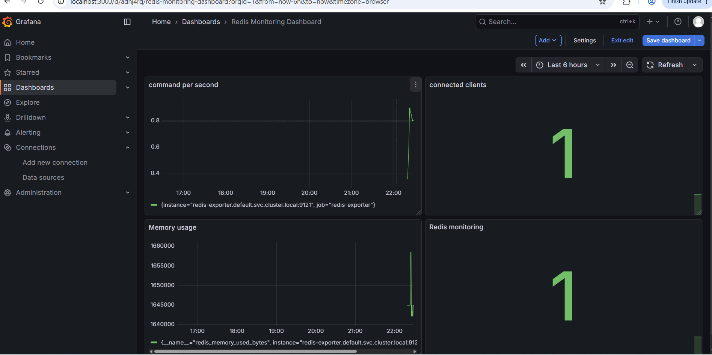
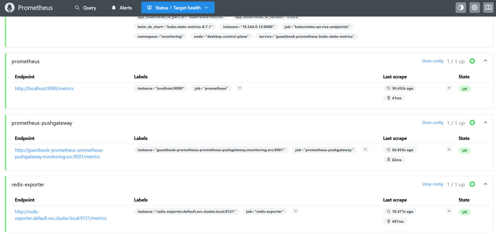

# Kubernetes Guestbook with Redis Monitoring

## Overview

This project deploys a Kubernetes-based Guestbook application backed by Redis and integrates Prometheus and Grafana for monitoring and observability.

The infrastructure is provisioned and managed using **Pulumi with TypeScript**, while Helm is used to deploy the monitoring components.

The goal is to demonstrate Kubernetes application deployment, infrastructure as code, Redis monitoring, and metrics visualization.

## Architecture

The project consists of the following components:

| Component | Description |
|---|---|
| Guestbook | Frontend application deployed with 3 replicas |
| Redis Leader | Primary Redis instance |
| Redis Replica | Redis replica instance |
| Redis Exporter | Exposes Redis metrics for Prometheus |
| Prometheus | Collects and stores monitoring metrics |
| Grafana | Displays Redis metrics through dashboards |

### Monitoring Data Flow

1. Redis runs as the application's data store.
2. Redis Exporter collects and exposes Redis metrics on port `9121`.
3. Prometheus scrapes metrics from Redis Exporter.
4. Grafana uses Prometheus as its data source.
5. Redis metrics are visualized through a Grafana dashboard.

## Technology Stack

- Kubernetes
- Docker Desktop
- Pulumi
- TypeScript
- Redis
- Redis Exporter
- Prometheus
- Grafana
- Helm

## Grafana Dashboard

The Grafana dashboard provides visibility into Redis performance through the following metrics:

- **Connected Clients:** Number of clients currently connected to Redis.
- **Memory Usage:** Memory consumed by the Redis instance.
- **Commands Per Second:** Redis command processing rate over time.

## Project Screenshots

### Grafana Redis Monitoring Dashboard



### Prometheus Targets



## Prerequisites

Before deploying the project, make sure you have:

- Docker Desktop with Kubernetes enabled
- Node.js and npm
- Pulumi CLI
- kubectl

## Deployment

### 1. Clone the repository

```bash
git clone https://github.com/deebihavelmurugan/guestbook-redis-monitoring.git
cd guestbook-redis-monitoring
```

### 2. Install dependencies

```bash
npm install
```

### 3. Initialize Pulumi

The project uses the local Pulumi backend.

```bash
pulumi login --local
```

Select the development stack:

```bash
pulumi stack select dev
```

### 4. Deploy the infrastructure

```bash
pulumi up
```

Review the proposed changes and confirm the deployment.

### 5. Verify Kubernetes resources

Check the deployed pods:

```bash
kubectl get pods --all-namespaces
```

Check services:

```bash
kubectl get services --all-namespaces
```

## Validation

The monitoring setup can be validated by checking:

- Redis Exporter is running.
- The `redis_up` metric returns a value of `1`.
- Prometheus shows the Redis Exporter target as **UP**.
- Grafana successfully queries Prometheus.
- The Grafana dashboard displays Redis metrics.

## Repository Structure

```text
components/
├── index.ts
├── k8sjs.ts
├── package.json
├── package-lock.json
├── tsconfig.json
├── Pulumi.yaml
├── Pulumi.dev.yaml
├── README.md
├── .gitignore
└── screenshots/
    ├── grafana-dashboard.png
    └── prometheus-targets.png
```

## Cleanup

To remove the resources created by Pulumi:

```bash
pulumi destroy
```

Review the proposed changes and confirm before deleting resources.

---

**Project Focus:** Kubernetes deployment, infrastructure as code, Redis administration, Prometheus monitoring, Grafana dashboards, and observability.
